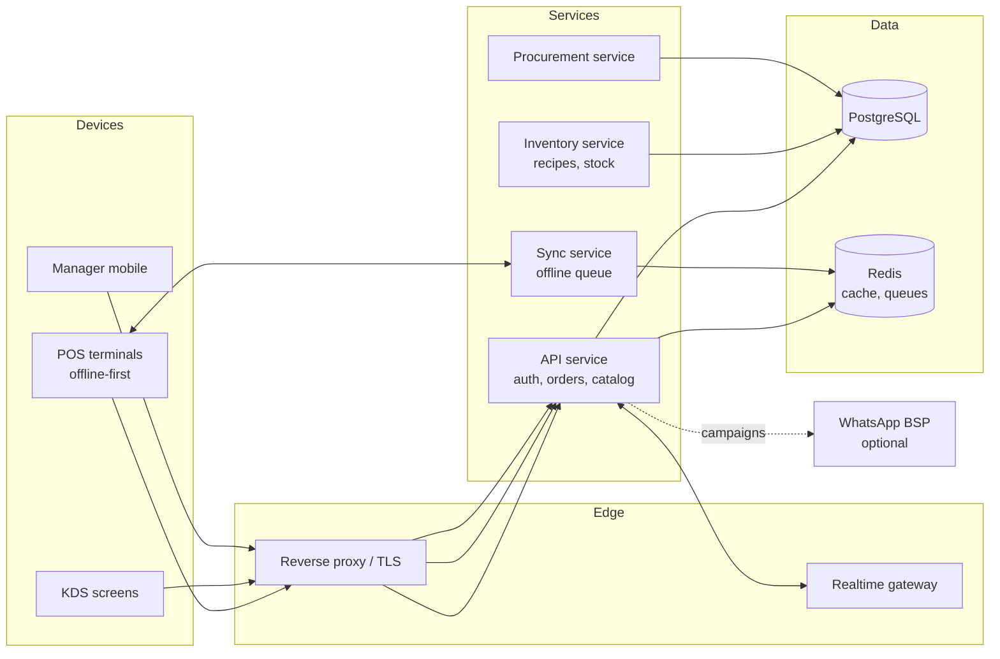

# RestoERP — Restaurant ERP System

> A complete, offline-first restaurant operations platform: point of sale,
> kitchen display, recipe-level inventory, procurement, staff, CRM and
> multi-branch analytics — built so the till keeps working when the internet does not.

**Status:** design specification and implementation roadmap. This repository
documents the system architecture and module design; code lands in the phases
described in [docs/roadmap.md](docs/roadmap.md).

---

## The problem this solves

A 3-branch restaurant in Lahore typically runs on a POS that only takes orders,
a spreadsheet for stock, WhatsApp for purchase orders, and a manager who
reconciles the three by hand at month end. The consequences are predictable:
food cost is a guess, portion variance is invisible, wastage is discovered only
in the P&L, and a 10-minute internet outage stops service.

RestoERP treats the restaurant as one system: every sale depletes stock through
a recipe, every purchase updates the landed cost, and every shift produces its
own P&L — with the POS surviving offline.

---

## Modules

### 1. Point of sale (offline-first)
- Dine-in, takeaway, delivery and aggregator orders; table map and floor plan
- Split bills, merged tables, course ordering (starters held back until mains)
- Modifiers and combos with their own price deltas and stock effects
- Multiple payment methods: cash, card, wallet, credit/khata, split tender
- **Offline mode:** orders, table state and payments are written to local
  storage (IndexedDB) and queued; the sync engine replays them in order when the
  connection returns. Conflict rules: server timestamp wins for stock, device
  UUID wins for the order, and a visible "unsettled shift" queue is shown to the
  cashier rather than silently dropping anything.
- Receipt printing (58 mm / 80 mm ESC/POS), reprints logged

### 2. Kitchen display system (KDS)
- Kiosk view per station (grill, fry, beverages) with ticket aging and colour
  escalation, plus an optional bump bar
- Course-based release, item availability toggle that instantly hides a dish on
  all terminals
- Prep-time feedback (promised vs. actual) feeds the ETA shown to delivery orders

### 3. Inventory & recipe costing
- Ingredient master with units and unit conversion
- **Recipe / bill of materials per menu item**, including sub-recipes (sauces,
  marinades) and yield percentage (cleaning + cooking loss)
- Sales auto-deplete stock through the recipe; manual wastage, staff meals and
  transfer entries are first-class
- Batch/lot tracking for perishables with expiry alerts
- Stock counts with variance reporting: theoretical vs. actual, priced at the
  latest landed cost

### 4. Procurement
- Purchase requisition → purchase order → goods receipt → supplier invoice
  (**three-way match**), with tolerance rules for short delivery and price drift
- Supplier scorecards: price trend, on-time delivery, short-ship rate, quality rejects
- Landed cost (freight + duty + wastage allowance) drives the recipe cost

### 5. Staff & compliance
- Employees, rosters and shifts; clock-in/out with geofence option
- Shift handover with cash drawer reconciliation (expected vs. counted)
- Roles: owner, branch manager, cashier, kitchen, storekeeper, accountant —
  enforced server-side on every endpoint
- Audit log: every price change, void, discount, stock adjustment and permission
  change is recorded with actor, timestamp and before/after value

### 6. CRM & loyalty
- Customer records, order history, favourites
- Loyalty points and tiers; **WhatsApp-first** campaigns (opt-in, template
  messages, one-tap unsubscribe) with reply handling
- Reservations and waitlist with SMS/WhatsApp confirmation

### 7. Analytics
- Branch-level P&L by shift, day, week
- Menu engineering matrix (stars / plough-horses / puzzles / dogs) from margin
  and velocity
- Food cost %, labour %, and prime cost trending
- Discount and void leakage report — who, how much, how often

---

## Architecture



**Key decisions**

- **Modular monolith, not microservices, for v1.** One deployable, clear module
  boundaries, shared database with schema-per-module discipline. Microservices
  are a scale decision, not an architecture fashion — the roadmap lists the
  first candidates to extract (sync and KDS realtime).
- **Offline POS is a sync problem, not a UI problem.** Client stores a full
  catalog and price list with a version number; every mutation is an immutable
  command with an idempotency key, so replay is safe.
- **Money and quantities are exact.** Integer minor units for money, decimal
  quantities, and never floating point on the client.
- **Every stock movement is an event.** Stock balance is a projection; the
  ledger is the source of truth. This makes audits and backdated corrections
  possible without recalculating history.

---

## Tech stack

| Layer | Choice | Why |
|---|---|---|
| Frontend | Next.js (App Router) + TypeScript | SSR shell, fast route changes, strong typing |
| POS client | React + IndexedDB (Dexie) + service worker | Real offline behaviour, not a cache layer |
| Backend | Node.js + TypeScript (NestJS-style modules) | Shared types with client, strong DI/testability |
| Database | PostgreSQL | Transactions, ledger queries, window functions for reports |
| Cache / queue | Redis + BullMQ | Print jobs, WhatsApp sends, report generation |
| Realtime | WebSockets | KDS tickets, table state, live sync |
| Auth | JWT access + refresh, bcrypt, server-side RBAC | Role enforcement cannot live in the UI |
| Infra | Docker Compose (dev), single VPS with managed backups (prod) | Cost-appropriate for a restaurant group |

---

## Non-functional requirements

- **Availability:** POS must operate with zero internet for at least 24 hours.
- **Latency:** add-to-ticket under 100 ms locally; KDS ticket delivery under 2 s online.
- **Integrity:** every order total must reconcile to the sum of its items and
  tax; the night job flags any mismatch, it never silently corrects it.
- **Security:** parameterised queries only, rate-limited auth, signed audit log,
  secrets outside the repo, per-branch data isolation enforced in SQL.
- **Backups:** nightly full + continuous WAL archiving; restore is tested monthly.
- **Accessibility:** POS usable with keyboard only; KDS readable from 2 m.

---

## Data model (core entities)

`organization` → `branch` → `terminal` · `user`/`role` · `menu_category` →
`menu_item` → `recipe_line` → `ingredient` · `stock_ledger` · `supplier` →
`purchase_order` → `goods_receipt` → `supplier_invoice` · `order` → `order_line`
→ `payment` · `shift` → `cash_drawer` · `customer` → `loyalty_account` ·
`audit_log`

Entity-relationship details and the migration plan are in
[docs/architecture.md](docs/architecture.md).

---

## Getting started (when code lands)

```bash
git clone https://github.com/hamidkhan069731-blip/restaurant-erp-system.git
cd restaurant-erp-system
cp .env.example .env        # set DATABASE_URL and JWT_SECRET
npm install
npm run db:migrate
npm run db:seed             # demo menu, recipes, stock, one branch
npm run dev
```

Demo logins and the seeded scenario are documented in the roadmap's Phase 1.

---

## Roadmap summary

| Phase | Scope | Exit criteria |
|---|---|---|
| 0 | Repo, schema, auth, branch/terminal model | A cashier can log into a branch |
| 1 | POS + KDS online, receipts | A full service can be run end-to-end |
| 2 | Offline POS + sync engine | Pull the network cable mid-service; nothing is lost |
| 3 | Inventory, recipes, stock ledger | Sales deplete stock correctly; variance report exists |
| 4 | Procurement + three-way match | A PO can be raised, received and matched |
| 5 | CRM, loyalty, WhatsApp | Opted-in customer receives a campaign |
| 6 | Multi-branch analytics + P&L | Month-end closes without a spreadsheet |

Full detail, acceptance tests and the out-of-scope list:
[docs/roadmap.md](docs/roadmap.md).

---

## License

MIT — see [LICENSE](LICENSE).
